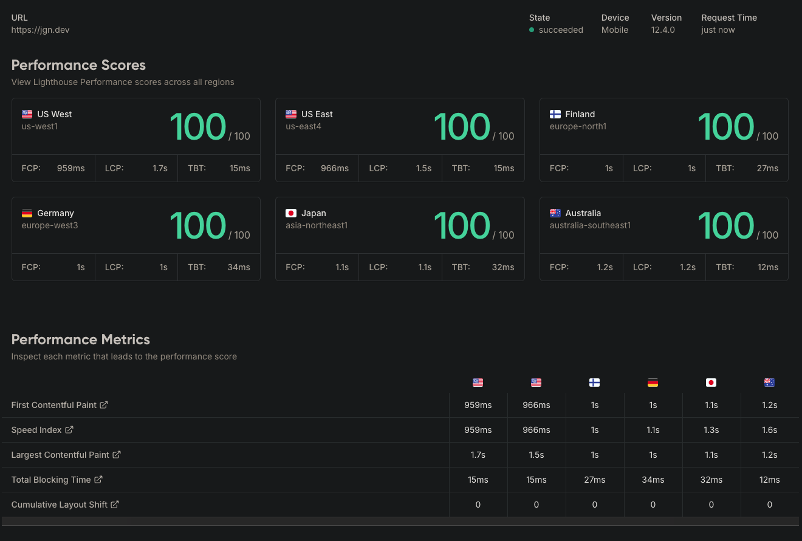
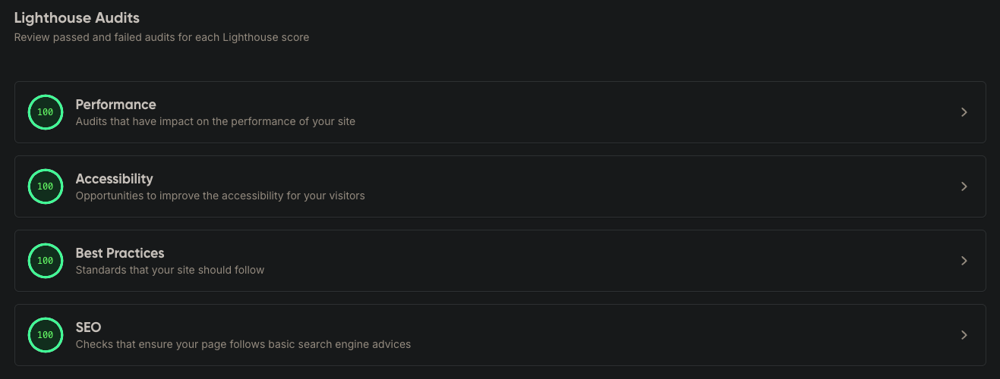

# jgn.dev

A modern, high-performance blog built with Go, Templ templates, and Tailwind CSS. Features real-time search, GitHub-repo based content management, and automatic post updates via webhooks.

You can give the live site a spin at <a href="https://jgn.dev" target="_blank">jgn.dev</a>

## ⚡ Performance First

Designed and optimized for exceptional web performance:

🏆 **100 Lighthouse Score** in all categories when deployed to GCP Cloud Run Service.




## 🚀 Features

- **Modern Go Stack**: Go 1.24 + Echo v4 + Templ templates + Tailwind CSS v4
- **GitHub Content Management**: Posts and Cheat Sheets stored as Markdown in GitHub repositories
- **Real-time Search**: HTMX-powered search with tag and title filtering for both posts and cheat sheets
- **Webhook Auto-Updates**: Automatically refreshes content when posts or cheat sheets are added to GitHub
- **Responsive Design**: Mobile-first design with dark/light mode support
- **Syntax Highlighting**: Code blocks with Tokyo Night Dark theme (consistent across light/dark modes)
- **SEO Optimized**: Structured data, meta tags, and semantic HTML
- **Production Ready**: Docker containerization for GCP Cloud Run deployment

## 🏗️ Architecture

```
┌─────────────────┐    ┌──────────────────┐    ┌─────────────────┐
│ GitHub Posts    │    │     jgn.dev      │    │   GitHub        │
│ & Cheat Sheets  │───▶│   Application    │◀───│   Webhook       │
│ (Markdown)      │    │   (Go + Templ)   │    │   (Auto-refresh)│
└─────────────────┘    └──────────────────┘    └─────────────────┘
         │                       │                       │
         ▼                       ▼                       ▼
┌─────────────────┐    ┌──────────────────┐    ┌─────────────────┐
│   Content API   │    │   GCP Cloud Run  │    │   Real-time     │
│   (GitHub API)  │    │   (Containers)   │    │   Search        │
│                 │    │                  │    │   (HTMX)        │
└─────────────────┘    └──────────────────┘    └─────────────────┘
```

## 🛠️ Technology Stack

**Backend:**
- Go 1.24 with Echo v4 framework
- Templ for type-safe HTML templates
- GitHub API for content management (posts and cheat sheets)
- HTMX for dynamic interactions

**Frontend:**
- Tailwind CSS v4 for styling
- Vanilla JavaScript for theme switching
- Highlight.js for syntax highlighting
- Responsive design with mobile navigation

**Infrastructure:**
- Docker for containerization
- GCP Cloud Run for hosting
- GCP Artifact Registry for image storage
- GCP Cloud Build for automated deployments

## 📁 Project Structure

```
jgn.dev/
├── docs/
│   ├── gcp-deployment-guide.md              # GCP Cloud Run deployment guide
│   ├── cicd-guide.md                        # CI/CD pipeline guide
│   ├── webhook-setup-guide.md               # GitHub webhook setup
│   └── github-token-setup-guide.md          # GitHub token configuration
├── internal/
│   ├── application/                         # HTTP handlers and controllers
│   ├── contentmanager/                      # GitHub integration and content fetching
│   ├── views/                              # Templ templates and components
│   └── site/                               # Site configuration and metadata
├── public/
│   ├── css/                                # Stylesheets and themes
│   ├── js/                                 # JavaScript files
│   ├── font/                              # Web fonts (Inter, JetBrains Mono)
│   ├── img/                               # Images and static assets
│   └── txt/                               # Text files (robots.txt)
├── scripts/
│   ├── deploy-gcp-cloud-run.sh            # GCP Cloud Run deployment script
│   ├── run-dev.sh                         # Development environment orchestration
│   ├── templ-watch.sh                     # Template hot reloading
│   ├── tailwind-watch.sh                  # CSS hot reloading
│   └── test-webhook.sh                    # Webhook testing utility
├── server/
│   └── main.go                            # Application entry point
├── Dockerfile                             # Container configuration
├── package.json                           # Tailwind CSS dependencies
├── go.mod                                 # Go module dependencies
└── README.md                              # This file
```

## 🚀 Quick Start

### Prerequisites

- Go 1.24+
- Docker (for deployment)
- Node.js (for Tailwind CSS)
- gcloud CLI (for GCP deployment)
- GitHub Personal Access Token ([setup guide](docs/github-token-setup-guide.md))

### Local Development

1. **Clone the repository**
   ```bash
   git clone https://github.com/jgndev/jgn.dev.git
   cd jgn.dev
   ```

2. **Install dependencies**
   ```bash
   go mod download
   go install github.com/a-h/templ/cmd/templ@latest
   go install github.com/cosmtrek/air@latest
   npm install
   ```

3. **Set environment variables**
   ```bash
   export GITHUB_TOKEN=your_github_token_here  # See: docs/github-token-setup-guide.md
   export GITHUB_WEBHOOK_SECRET=$(openssl rand -hex 32)  # Optional
   ```

4. **Start development environment**
   
   **Option A: All-in-One Script (Recommended)**
   ```bash
   ./scripts/run-dev.sh
   ```
   
   This single command:
   - ✅ Checks prerequisites and environment
   - ✅ Runs initial builds
   - ✅ Starts Tailwind CSS watch (background)
   - ✅ Starts Templ template watch (background)  
   - ✅ Starts Air Go hot reload (foreground)
   - ✅ Provides proper cleanup on Ctrl+C
   
   **Additional commands:**
   ```bash
   ./scripts/run-dev.sh stop      # Stop all processes
   ./scripts/run-dev.sh restart   # Restart all processes
   ./scripts/run-dev.sh status    # Show process status
   ```
   
   **Option B: Manual Setup (Advanced)**
   
   If you prefer to run each process manually in separate terminals:
   
   **Terminal 1 - Templ Watch:**
   ```bash
   ./scripts/templ-watch.sh
   ```
   
   **Terminal 2 - Tailwind Watch:**
   ```bash
   ./scripts/tailwind-watch.sh
   ```
   
   **Terminal 3 - Go Server with Air:**
   ```bash
   air
   ```

5. **Visit** http://localhost:8080

   The application will automatically reload when you make changes to:
   - Go files (via Air)
   - Templ templates (via templ-watch.sh)
   - CSS styles (via tailwind-watch.sh)

## 🌐 Deployment to GCP Cloud Run

Deploy to GCP Cloud Run for cost-effective, scalable hosting:

### Quick Deployment
```bash
export PROJECT_ID=your-gcp-project-id
export GITHUB_TOKEN=your_token
export GITHUB_WEBHOOK_SECRET=your_webhook_secret
./scripts/deploy-gcp-cloud-run.sh
```

**Why Cloud Run:**
- ✅ Pay-per-use pricing (can cost as little as $0-5/month for low traffic)
- ✅ Automatic scaling to zero when not in use
- ✅ Built-in SSL certificates and global load balancing
- ✅ Easy custom domain configuration
- ✅ Integrated CI/CD with Cloud Build
- ✅ Better cost efficiency compared to always-on services
- ✅ Built-in health monitoring and auto-restart

📖 **Detailed Instructions**: See [GCP Deployment Guide](docs/gcp-deployment-guide.md) for complete setup instructions and configuration options.

## 🔄 CI/CD Pipeline

This project uses GitHub Actions for automated CI/CD with optimized Docker builds:

### Features
- ✅ **Smart CI Pipeline**: Runs comprehensive code quality checks on all branches except main
- ✅ **Automated Deployment**: Builds and deploys Docker images when PRs are merged to main
- ✅ **Cost Optimized**: Pre-built images eliminate expensive Cloud Build cycles
- ✅ **Fast Deployments**: Pre-built Docker images deploy 3-5x faster
- ✅ **Automatic Cleanup**: Maintains only the 10 most recent images
- ✅ **Health Checks**: Built-in deployment verification

### Workflows
- **CI Pipeline** (`.github/workflows/ci.yml`): Code formatting, linting, testing, and vulnerability scanning
- **Deployment Pipeline** (`.github/workflows/deploy.yml`): Docker build, push to Artifact Registry, and Cloud Run deployment

📖 **Setup Instructions**: See [DEPLOYMENT.md](DEPLOYMENT.md) for complete GitHub Actions configuration and required secrets.

## 🔄 GitHub Webhook Setup

Enable automatic content updates when you add new blog posts:

1. Generate a webhook secret: `openssl rand -hex 32`
2. Configure the webhook in your GitHub posts repository
3. Set the webhook URL to: `https://yourdomain.com/webhook/github`

📖 **Detailed Instructions**: See [Webhook Setup Guide](docs/webhook-setup-guide.md) for step-by-step configuration.

## ✨ Key Features

### Content Management
- **GitHub Integration**: Posts and Cheat Sheets stored as Markdown files in separate GitHub repositories
- **Automatic Refresh**: Webhook-triggered content updates without server restarts
- **Frontmatter Support**: YAML frontmatter for post and cheat sheet metadata (title, date, author, summary, tags, etc.)

### Search & Navigation
- **Real-time Search**: HTMX-powered search across post titles and tags
- **Posts Listing**: Paginated view of all posts, sorted by date
- **Individual Post Pages**: Clean, readable post layout with syntax highlighting
- **Cheat Sheets Listing**: Paginated view of all cheat sheets, sorted by date
- **Cheat Sheets Search**: Search for cheat sheets by title or tag
- **Individual Cheat Sheet Pages**: Clean, readable cheat sheet layout with syntax highlighting
- **Mobile Navigation**: Hamburger menu with smooth animations

### Performance & SEO
- **Fast Loading**: Optimized Docker images and efficient Go backend
- **Consistent Syntax Highlighting**: Tokyo Night Dark theme in both light and dark modes
- **Dark/Light Mode**: Enhanced dark mode with deeper colors
- **Responsive Design**: Mobile-first approach with Tailwind CSS

## 🔧 Configuration

### Environment Variables

**Required:**
- `GITHUB_TOKEN`: Personal access token for GitHub API access ([setup guide](docs/github-token-setup-guide.md))

**Optional:**
- `GITHUB_WEBHOOK_SECRET`: Secret for webhook signature verification
- `PORT`: Server port (default: 8080)

### Site Configuration

Edit `internal/site/site.go` to configure:
- Post and cheat sheet repository owners and names
- Site metadata and branding
- Navigation links

## 📝 Content Management

### Adding Blog Posts

1. **Create a Markdown file** in your posts repository
2. **Add frontmatter**:
   ```yaml
   ---
   id: unique-post-id
   title: "Your Post Title"
   date: 2024-01-15T00:00:00Z
   author: "Jeremy Novak"
   tags: ["go", "web-development", "gcp"]
   slug: your-post-slug
   published: true
   summary: "A short summary of the post."
   ---
   ```
3. **Write your content** in Markdown
4. **Commit and push** - the site will automatically update via webhook  

💡 Check out the posts repository at [github.com/jgndev/posts](https://github.com/jgndev/posts) for examples.

### Adding Cheat Sheets

1. **Create a Markdown file** in your cheatsheets repository ([github.com/jgndev/cheatsheets](https://github.com/jgndev/cheatsheets))
2. **Add frontmatter**:
   ```yaml
   ---
   id: unique-cheatsheet-id
   title: "Go Slices Cheat Sheet"
   date: 2024-01-20T00:00:00Z
   author: "Jeremy Novak"
   tags: ["go", "slices", "reference"]
   slug: go-slices
   published: true
   summary: "Quick reference for Go slices syntax and operations."
   ---
   ```
3. **Write your cheat sheet content** in Markdown
4. **Commit and push** - the site will automatically update via webhook  

💡 See [github.com/jgndev/cheatsheets](https://github.com/jgndev/cheatsheets) for examples.

### Supported Frontmatter Fields

- `id`: Unique identifier for the post or cheat sheet
- `title`: Title (required)
- `date`: Publication date in RFC3339 format
- `author`: Author name
- `summary`: Short summary for cards and SEO
- `tags`: Array of tags for categorization
- `slug`: URL slug (auto-generated if not provided)
- `published`: Boolean to control visibility

## 🔍 Search & Navigation

- **Posts**: `/posts` (browse, search, and filter posts)
- **Cheat Sheets**: `/cheatsheets` (browse, search, and filter cheat sheets)
- **Search**: `/search` (posts), `/cheatsheets/search` (cheat sheets)
- **Individual Pages**: `/posts/:slug`, `/cheatsheets/:slug`

## 🔄 Continuous Integration (CI)

This project uses a comprehensive GitHub Actions workflow for every push and pull request:

- **Formatting**: `go fmt` and `goimports` for code and import style
- **Static Analysis**: `go vet`, `staticcheck`, and `golangci-lint` (includes ineffassign, misspell, errcheck, gosec, gocyclo, and more)
- **Vulnerability Scanning**: `govulncheck` for dependency security
- **Templ Generation**: Ensures all Templ files are generated before analysis
- **Build**: Verifies the application builds
- **Tests**: Runs all Go tests with race detection and coverage
- **Coverage**: Uploads coverage to Codecov

See `.github/workflows/ci.yml` for the full workflow.

## 🐳 Docker

### Build Image
```bash
docker build -t jgn-dev .
```

### Run Container
```bash
docker run -p 8080:8080 \
  -e GITHUB_TOKEN=your_token \
  -e GITHUB_WEBHOOK_SECRET=your_secret \
  jgn-dev
```

## 🧪 Testing

### Test Webhook Locally
```bash
export GITHUB_WEBHOOK_SECRET=your_secret
./scripts/test-webhook.sh
```

### Run Application Tests
```bash
go test ./...
```

## 🚨 Troubleshooting

### Common Issues

1. **Templ generation fails**
   - Install templ CLI: `go install github.com/a-h/templ/cmd/templ@latest`
   - Run `templ generate` before building

2. **Tailwind styles not loading**
   - Build CSS: `npx tailwindcss -i ./public/css/style.css -o ./public/css/site.css --minify`
   - Check file paths in templates

3. **GitHub API rate limiting**
   - Set `GITHUB_TOKEN` environment variable ([setup guide](docs/github-token-setup-guide.md))
   - Verify token has repository read permissions

4. **Webhook not working**
   - Check webhook secret matches environment variable
   - Verify webhook URL is publicly accessible
   - Check server logs for error messages

5. **GCP deployment issues**
   - Verify gcloud authentication: `gcloud auth list`
   - Check project permissions and enabled APIs
   - Review Cloud Run service logs in GCP Console

6. **Font files not loading (404 errors)**
   - Ensure fonts are copied in Dockerfile: `COPY --from=go-builder /app/public/font/ ./public/font/`
   - Rebuild and redeploy the container image

## 💰 Cost Optimization

GCP Cloud Run pricing is usage-based, making it very cost-effective:

- **CPU**: $0.00002400 per vCPU-second
- **Memory**: $0.00000250 per GiB-second
- **Requests**: $0.40 per million requests
- **Networking**: Egress charges apply

**Estimated costs for a personal blog:**
- **Low traffic** (1K visits/month): $0-2/month
- **Medium traffic** (10K visits/month): $2-8/month
- **High traffic** (100K visits/month): $15-30/month

## 📚 Documentation

- **[Deployment Setup](DEPLOYMENT.md)**: GitHub Actions CI/CD setup, required secrets, and GCP configuration
- **[Project Overview](docs/project-overview.md)**: Comprehensive project architecture and feature overview
- **[GCP Deployment Guide](docs/gcp-deployment-guide.md)**: Complete GCP Cloud Run deployment instructions
- **[CI/CD Guide](docs/cicd-guide.md)**: CI/CD pipeline configuration and setup
- **[GitHub Token Setup Guide](docs/github-token-setup-guide.md)**: Step-by-step guide to create and configure GitHub Personal Access Tokens
- **[Webhook Setup Guide](docs/webhook-setup-guide.md)**: GitHub webhook configuration for automatic updates

## 🤝 Contributing

1. Fork the repository
2. Create a feature branch: `git checkout -b feature/amazing-feature`
3. Commit changes: `git commit -m 'Add amazing feature'`
4. Push to branch: `git push origin feature/amazing-feature`
5. Open a Pull Request

## 📄 License

This project is licensed under the MIT License - see the [LICENSE](LICENSE.md) file for details.

## 📞 Support

- **Documentation**: Check the guides in the `docs/` folder
- **Issues**: Open a GitHub issue for bugs or feature requests
- **Contact**: [Open an issue](https://github.com/jgndev/jgn.dev/issues) for support

---

Built with 🤓 using Go, Templ, Tailwind CSS, and deployed on GCP Cloud Run